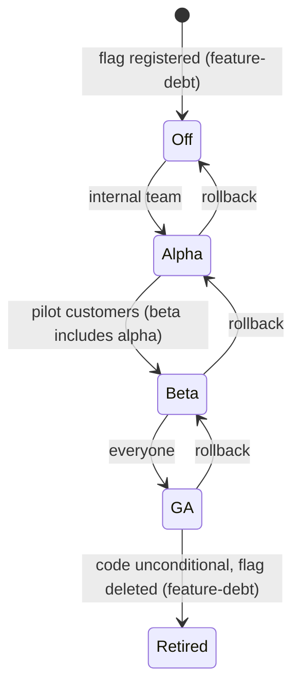

<!-- GENERATED MIRROR - DO NOT EDIT. Source: .claude/skills/feature-flag-rollout/SKILL.md - Regenerate: make sync-agents -->

# /feature-flag-rollout — Stage transitions, tester communication and usage

The panel (`https://flags.jc.proxy.vpn.etendo.cloud`) owns each flag's stage, rings, messages
and Datadog sync. Drive it with the CLI (`make flags ARGS="..."`, `cli/src/flags-panel.js`; see
`docs/feature-flags.md` → *Flags panel CLI*). Registering the flag, its debt and removing it from
the code is the `feature-debt` skill.



## Rules

- **Nothing leaves without the human's yes.** Show the plan before `apply --yes`, and the
  final subject, body and recipient list before `notify --yes`. A plan where someone loses
  access or an unmanaged rule is deleted needs an explicit OK even with `--force` available.
- **Apply, verify, then announce.** `apply --yes` runs `check`; notify only when Datadog
  matches the panel. `notify` refuses a pending flag on purpose.
- **Test-send to the human first** (`notify <key> --test`, which sends one copy to the signed-in
  user like the panel's test button; `--test <email>` for someone else) and let them read
  it in their inbox before the real send.
- Emails follow the templates below. The panel's AI draft (`comms <key> draft`) is a starting
  point only: rewrite it into the template before saving.
- One message version per stage. Testers added later get the same version: `notify` sends only
  to people not notified yet.

## Transitions

Every transition is the same loop; the checklists say what must be true before it.

```bash
make flags ARGS="show <key>"                 # current stage, rings, sync
make flags ARGS="stage <key> <stage>"        # or: ring <key> <alpha|beta> add|rm <email|@group>
make flags ARGS="plan <key>"                 # show the human who gains / loses
make flags ARGS="apply <key> --yes"          # pushes to Datadog and runs check
make flags ARGS="comms <key> save --subject '…' --body-file /tmp/<key>-<stage>.md"
make flags ARGS="comms <key> preview"        # HTML file to open
make flags ARGS="notify <key> --test"        # one copy to the signed-in user
make flags ARGS="notify <key>"               # dry run: recipient list for the human
make flags ARGS="notify <key> --yes"
```

### Off → Alpha (internal team)

- [ ] Flag registered in `flags-registry.json` with owner, Jira and TTL (`feature-debt`).
- [ ] Owner and team set in the panel; type confirmed (`type <key> <type>`): it sets the TTL target.
- [ ] Usage measurement decided (table below) and, for a front-end feature, the event name saved
      in the panel's "Evento de uso" field.
- [ ] Alpha ring: internal people or groups only (`@comite`, named teammates).
- [ ] Email: **Alpha invitation** template.

### Alpha → Beta (pilot customers)

- [ ] Alpha feedback read (`raw GET /api/flags/<key>/feedback`); no open "algo falla" or
      "quiero desactivarla" left unanswered.
- [ ] Usage seen during alpha (table below): someone used it and it worked.
- [ ] Help page in help.etendo.ai exists, or the human accepts its absence (the beta email links it).
- [ ] Beta ring defined with groups (`@etendo-ai`, a customer group). Beta always includes alpha.
- [ ] Email: **Beta invitation** template. Alpha testers already notified are not emailed again.

### Beta → GA (everyone)

- [ ] Beta usage and feedback reviewed with the owner; the decision is recorded in the panel's
      meeting notes or the Jira ticket.
- [ ] `plan` shows `gain: EVERYONE` and no unmanaged rule lost.
- [ ] No email at GA: publish a **GA release note** (`comms <key> save --channel release-notes …`,
      then `notify <key> --yes` publishes it in Novedades).
- [ ] Open the retirement: TTL set to a near date and a ticket to remove the flag (`feature-debt`,
      Step 6). Datadog keys are archived only after the release without the flag is deployed
      everywhere.

### Rollback (any stage back, or off)

- [ ] Move the stage back (`stage <key> <previous>`), `plan`, `apply --yes`.
- [ ] Email the affected testers with the **Rollback** template the same day.
- [ ] Record the reason in the Jira ticket.

## Measuring real usage

Datadog only tells who has the flag on (exposure). Who actually uses the feature depends on
where the feature runs; decide it at Off → Alpha.

| Feature runs in | How usage is measured | Where to read it |
|---|---|---|
| The SPA (something the user does on screen) | An event in `tools/app-shell/src/lib/observability/events.js` (`defineEvent`, channel Mixpanel), tracked where the real use happens; its name in the panel's "Evento de uso" field | Panel → KPIs; Mixpanel |
| An MCP tool | Nothing to add: every call is a row of `ETGO_MCP_USAGE` (`tool_name`) | `scripts/mcp-usage-dump.sh --include-reviewed --since <date> production` (skill `mcp-audit`) |
| A backend process or service | `com.etendoerp.go` `usageevents/UsageEventRecorder` (`ETGO_USAGE_EVENT`), or the business table it writes | Read-only SQL on the host (`scripts/lib/remote-etendo-psql.sh`) |
| A kill switch or an operational lever | Not usage: watch that it stays at its normal value | `check <key>` |

## Email templates

Recipients read Spanish: the templates are Spanish, in the voice of the panel's existing
messages (tú, short paragraphs, **bold** section titles, signed "Equipo Etendo"). The panel adds
the layout and the feedback link. Fill every `{{…}}`; remove a line rather than leave it empty.

### Alpha invitation — channel `email`

```markdown
Asunto: Prueba {{nombre de la funcionalidad}} en Etendo (fase alfa)

Hola:

Ya puedes probar {{nombre de la funcionalidad}} en Etendo. Está en fase alfa: la ve solo el equipo interno y necesitamos tu ojo crítico antes de abrirla a clientes.

{{Qué es, en una o dos frases, desde lo que ve el usuario.}}

**Dónde está**

{{Menú o pantalla, o la herramienta del MCP y cómo pedírsela al agente.}}

**Qué te pedimos**

- {{Tarea concreta 1}}
- {{Tarea concreta 2}}
- {{Tarea concreta 3}}
- Cuéntanos qué te ha resultado confuso, lento o poco intuitivo.

**Lo que todavía no hace**

- {{Limitación conocida}}

**Cómo darnos feedback**

Responde directamente a este email. Una captura de pantalla y lo que estabas haciendo nos ayudan mucho.

Gracias por probarlo.

Equipo Etendo
```

### Beta invitation — channel `email`

```markdown
Asunto: Novedad en Etendo: {{nombre de la funcionalidad}} (beta)

Hola:

Te hemos elegido para probar antes que nadie {{nombre de la funcionalidad}}. Está en fase beta: funciona y la estamos abriendo a un grupo reducido de clientes para ajustarla con vuestra experiencia.

{{Qué es y qué problema resuelve, en dos o tres frases.}}

**Cómo empezar**

1. {{Paso 1: dónde entrar}}
2. {{Paso 2}}
3. {{Paso 3}}

Tienes la guía completa en {{enlace a help.etendo.ai}}.

**Qué esperamos de ti**

Úsala en tu trabajo real durante {{las próximas semanas}} y cuéntanos qué te sobra, qué te falta y si algo falla.

**Cómo darnos feedback**

Responde a este email o usa el enlace «Dar mi opinión». Si prefieres no seguir en la beta, dínoslo y la desactivamos.

Gracias por ayudarnos a mejorar Etendo.

Equipo Etendo
```

### GA release note — channel `release-notes`

```markdown
Asunto: {{Nombre de la funcionalidad}}

{{Qué puedes hacer ahora, en una frase que empiece por un verbo.}}

{{Para qué sirve y a quién le ahorra trabajo, en dos o tres frases.}}

**Dónde está:** {{menú o pantalla}}.

Más detalles en {{enlace a help.etendo.ai}}.
```

### Rollback — channel `email`

```markdown
Asunto: Pausamos {{nombre de la funcionalidad}} en Etendo

Hola:

Hemos desactivado temporalmente {{nombre de la funcionalidad}} mientras corregimos {{motivo, sin tecnicismos}}.

**Qué significa para ti**

- {{Qué deja de ver o hacer}}
- {{Qué pasa con lo que ya creó: se conserva / no se pierde nada}}

Te avisaremos en cuanto vuelva a estar disponible. Gracias por tu paciencia y por el feedback que nos ayudó a detectarlo.

Equipo Etendo
```

### Feedback reminder — channel `email`, optional, about two weeks into a stage

```markdown
Asunto: ¿Qué tal con {{nombre de la funcionalidad}}?

Hola:

Hace {{dos semanas}} activamos {{nombre de la funcionalidad}} en tu cuenta. Nos ayudaría mucho saber cómo te ha ido.

- ¿La has usado? Si no, ¿qué te lo impidió?
- ¿Qué cambiarías?

Basta con responder a este email con un par de líneas.

Gracias,

Equipo Etendo
```

## Known panel issues

- Applying a change to a flag that is already in **beta** fails with
  `Datadog 409: allocation with this key already exists` (reported to the panel team on
  2026-11-26). Until it is fixed, a beta flag cannot be edited from the panel. The workaround
  (beta → alpha, apply, back to beta, apply) briefly removes access from every beta tester: ask
  the human first.
- Rings take emails and `@groups` only, not domains; `apply` deletes Datadog rules the panel does
  not manage (shown as `rules removed` in `plan`).

## Do not

- Notify before `apply` has been verified with `check`.
- Send a message the human has not read in its final form, or skip the `--test` send.
- Email customers at GA: publish the release note instead.
- Archive a Datadog flag before the release without it is deployed everywhere.
